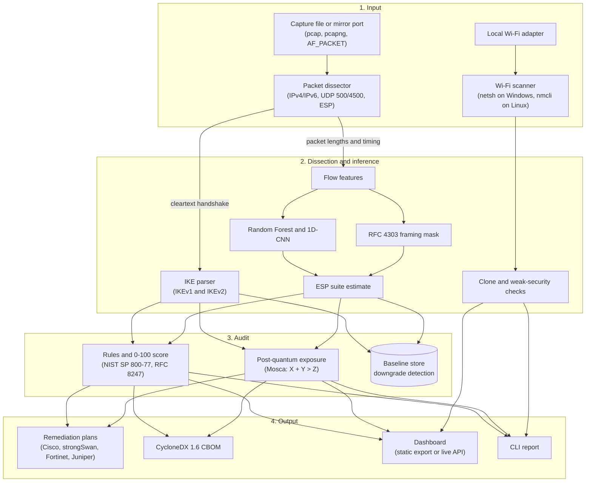

# Architecture

CipherGuard reads mirrored traffic and reports the cryptographic posture of the
IPsec tunnels in it. It holds no keys and decrypts nothing. A second, smaller
path audits the Wi-Fi networks visible to the local adapter.

[METHOD.md](METHOD.md) covers the method, the validation and the limitations.
This file covers how the code is laid out and the rules it is held to.

## Pipeline



`cipherguard/pipeline.py` runs stages 1 to 3 for one capture file and returns a
scored assessment. Every output in stage 4 is built from that assessment.

## Observed and inferred

Every value the tool reports is one of two kinds, and the code, the JSON and
the dashboard keep them apart.

| | Observed | Inferred |
|---|---|---|
| Source | Cleartext headers: IKE proposals, transforms, DH groups, SPIs, Wi-Fi beacons | Encrypted ESP flows: length residues, entropy, timing |
| Certainty | Read directly from the wire | A ranked estimate with a confidence |
| Dashboard colour | Teal (`--observed`, `#1b6e8c`) | Violet (`--inferred`, `#6d4e9c`) |

An inferred value is never presented as a fact. The CBOM carries the same
distinction as a `cipherguard:provenance` property on each component.

## Repository layout

```
cipherguard/                       # Repository root
├── README.md                      # Overview, quick start, measured results
├── GETTING-STARTED.md             # Install and demo walkthrough
├── ARCHITECTURE.md                # This file
├── METHOD.md                      # Method, validation and limitations in full
├── OPERATIONS.md                  # CLI, dashboard, sensor and security posture
├── CLAUDE.md                      # Working rules for coding agents
├── CONTRIBUTING.md, SECURITY.md   # How to contribute and report vulnerabilities
├── CHANGELOG.md                   # Release history
├── LICENSE, NOTICE                # Apache License 2.0 and attributions
├── pyproject.toml                 # Packaging, metadata and lint configuration
├── requirements.txt               # Runtime and dashboard dependencies
├── requirements.lock              # The same, pinned (`make lock`)
├── .env.example                   # Every environment variable the tool reads
├── Makefile                       # install, test, lint, serve, demo, lock
├── Dockerfile                     # Container image
├── render.yaml                    # Render deployment blueprint
├── launch_dashboard.bat           # Windows launcher
│
├── cipherguard/                   # Python package
│   ├── cli.py                     # CLI entry point (18 subcommands)
│   ├── pipeline.py                # Capture file in, scored assessment out
│   │
│   ├── core/                      # Shared model and arithmetic
│   │   ├── models.py              # Data model shared by dissector, audit, inference and API
│   │   ├── constants.py           # IANA registry tables for IKEv1 / IKEv2 / ESP
│   │   ├── framing.py             # RFC 4303 framing arithmetic
│   │   ├── strength.py            # Quantified security strength
│   │   ├── grouping.py            # Findings grouped by rule, per-link views
│   │   ├── audit_log.py           # Structured audit logging
│   │   ├── health.py              # Sensor health checks
│   │   └── retention.py           # Evidence retention for window captures
│   │
│   ├── dissector/                 # Protocol dissection
│   │   ├── pcap.py                # Capture file I/O and L2/L3/L4 decoding
│   │   ├── ike.py                 # IKEv1 and IKEv2 dissector (one module)
│   │   ├── esp.py                 # ESP flow tracking
│   │   └── wire_inspector.py      # ESP wire framing and raw hex inspector
│   │
│   ├── ml/                        # ESP inference
│   │   ├── features.py            # Side-channel features for encrypted ESP flows
│   │   ├── synth.py               # Labelled ESP flows for training and calibration
│   │   ├── classifier.py          # Inference engine: Random Forest plus the framing mask
│   │   ├── cnn.py                 # 1D-CNN implemented directly on NumPy
│   │   ├── train.py               # Model training and serialisation
│   │   └── validate.py            # Cross-model validation and mask ablation
│   │
│   ├── audit/                     # Rules and scoring
│   │   ├── engine.py              # Rules, 0-100 scoring and the rule catalogue
│   │   ├── policy.py              # Cryptographic policy baseline
│   │   ├── policy_config.py       # External policy overlay
│   │   └── plain.py               # One plain-language sentence per rule
│   │
│   ├── intel/                     # Baseline and post-quantum exposure
│   │   ├── baseline.py            # SQLite baseline store and downgrade detection
│   │   └── pqc.py                 # Mosca exposure and migration sequencing
│   │
│   ├── wifi/                      # Wi-Fi audit
│   │   ├── wlan_native.py         # Native Windows WLAN AutoConfig scanner
│   │   ├── auditor.py             # Wi-Fi posture audit and clone detection
│   │   └── models.py              # Wi-Fi assessment data structures
│   │
│   ├── vpn/                       # VPN tunnel and overlay detection
│   │   ├── detector.py            # Active tunnels, route redirects, DNS leaks
│   │   └── models.py              # VPN detection data structures
│   │
│   ├── remediation/               # Vendor configuration synthesis
│   │   ├── synth.py               # Plan synthesis for every supported platform
│   │   ├── rollback.py            # Rollback plan synthesis
│   │   ├── syntax.py              # Syntax check of generated plans
│   │   ├── dispatcher.py          # Dry-run validation and execution dispatcher
│   │   ├── store.py               # SQLite plan store with maker-checker approvals
│   │   └── models.py              # Remediation plan data structures
│   │
│   ├── export/                    # Machine-readable output
│   │   ├── cbom.py                # CycloneDX 1.6 CBOM serialiser
│   │   ├── payload.py             # The analysis payload, built once for every client
│   │   ├── static_site.py         # `export-demo`: writes the static dashboard
│   │   └── live_wifi_snapshot.json  # Example Wi-Fi scan (invented networks)
│   │
│   ├── capture/                   # Live capture
│   │   ├── live.py                # Live capture from a network interface
│   │   ├── live_sniffer.py        # Dashboard packet sniffer and event stream
│   │   └── sensor.py              # Continuous sensor mode
│   │
│   ├── lab/                       # Reference testbed and validation
│   │   ├── pcapgen.py             # Reference testbed capture generator
│   │   ├── labels.py              # User-labelled real captures
│   │   ├── realworld.py           # Validation against a public capture corpus
│   │   ├── fieldmodel.py          # Independent traffic model for cross-validation
│   │   └── bench.py               # Reproducible throughput benchmark
│   │
│   └── api/                       # Local FastAPI server
│       ├── server.py              # FastAPI app and every route (REST under /api/)
│       ├── security.py            # Host allowlist, cross-site refusal, headers, rate limits
│       └── static/                # The dashboard: index.html, 404.html,
│                                  #   css/dashboard.css, js/ (see below),
│                                  #   fonts/, img/
│
├── docs/                          # Output of `cipherguard export-demo` (GitHub Pages root):
│                                  #   a copy of api/static/ plus precomputed data/
├── tests/                         # Pytest suite
├── scripts/                       # Release, soak, capture-fetch and export helpers
├── deploy/                        # systemd unit for the sensor
├── samples/                       # Lab captures written by `cipherguard lab`
├── models/                        # Serialised model weights (rf.joblib, cnn.npz)
└── docker/                        # strongSwan interoperability lab
```

## Subsystems

### ESP inference

An ESP payload hides its cipher, but RFC 4303 pads the encrypted region to the
cipher's block size, so the packet lengths on one SA share a residue that
depends on the block size, IV length and ICV length. `core/framing.py` holds
that arithmetic.

Three parts use it, all in `ml/`:

- A Random Forest over length, residue, entropy and timing features.
- A small 1D-CNN written directly on NumPy, so no deep-learning runtime is
  needed.
- A framing mask that removes every suite the observed residues rule out.

The mask always wins. If a model prefers a suite the wire arithmetic excludes,
that suite is dropped and the exclusion is reported with its reason. The
"How ESP inference works" and "Measured accuracy, and its ceiling" sections of
[METHOD.md](METHOD.md) give the derivation and the numbers.

### IKE dissection and hybrid key exchange

`dissector/ike.py` parses IKEv1 (Main, Aggressive and Quick Mode) and IKEv2
(`IKE_SA_INIT`, `IKE_AUTH`, `CREATE_CHILD_SA`) and stops at the encrypted
payload.

For post-quantum hybrids it also reads:

- RFC 9370 additional key exchange transforms (types 6 to 12), named from the
  key exchange registry, including ML-KEM-512/768/1024 (groups 35 to 37).
- The `IKE_INTERMEDIATE` (RFC 9242) and `IKE_FOLLOWUP_KE` (RFC 9370) exchanges,
  which are recognised and counted per session.

Rule IKE-007 ("No quantum-resistant key establishment") is withdrawn only when
the responder-selected proposal contains a post-quantum group, or the responder
sends `USE_PPK`. A post-quantum exchange that was offered and not selected is
not credited. `core/strength.py` scores a hybrid at its strongest component
against each adversary.

Limits:

- The additional key exchange payloads are encrypted. The tool sees which
  exchange was negotiated and that it occurred, not what it carried or whether
  it succeeded.
- This path has been validated against the lab generator (`pqc_hybrid.pcap`,
  `pqc_declined.pcap`), not against a capture from a real RFC 9370
  implementation.
- ML-DSA authentication happens inside the encrypted `IKE_AUTH`, so a passive
  dissector cannot see it.
- The baseline store compares classical strength only, so losing a hybrid is
  not yet recorded as a downgrade by `watch`.

### Baseline store and downgrade detection

`intel/baseline.py` keeps a SQLite database with two tables:

- `observations`: one row per peer pair per capture, with the IKE version,
  vendor family, classical and quantum security bits, DH group, transforms and
  score.
- `baselines`: the strongest configuration seen for each peer pair and when it
  was first and best seen.

`cipherguard watch` records a capture against the baseline and exits with
code 3 if any peer pair is weaker than its baseline.

### Wi-Fi audit

`wifi/` reads the networks the operating system already knows about. It does
not need a capture driver.

- Windows: `netsh wlan show interfaces` and `netsh wlan show networks mode=bssid`.
- Linux: `nmcli dev wifi`.

Clone detection groups the networks in range by SSID. When one SSID is
broadcast by several access points and some advertise weaker security than the
rest, the weaker ones are flagged as likely clones. Several access points with
matching security are treated as an ordinary mesh. The score is reduced only
when the cloned network is the one this host is connected to.

### Remediation

`remediation/synth.py` writes hardening plans for Cisco IOS / IOS-XE,
strongSwan (swanctl), Fortinet FortiOS and Juniper SRX, each with a rollback
plan. `remediation/store.py` holds plans in SQLite behind a maker-checker
approval step.

## Design rules

These hold across the codebase. `tests/test_guarantees.py` and
`tests/test_offline.py` enforce several of them.

1. **No decryption.** The tool never asks for, accepts or stores private keys,
   pre-shared keys or session keys. Encrypted traffic is assessed from
   metadata only.
2. **No payload retention.** Packet payload bytes are never written to disk, a
   database or a log. KE values and nonces are reduced to digests on the way
   in.
3. **The framing mask constrains the models.** A model output that contradicts
   the wire arithmetic is discarded, and an estimate is never reported as a
   certainty.
4. **Observed and inferred stay separate** in data models, exports and the
   interface.
5. **Works offline.** No outbound network calls and no CDN dependencies. Fonts
   are bundled.
6. **Loopback by default.** `cipherguard serve` binds to `127.0.0.1`. A
   non-loopback bind is refused unless a token is set in `CIPHERGUARD_TOKEN`
   or `--insecure-bind` is passed. Without a token the server also answers
   loopback host names only and refuses state-changing requests from another
   web site (`api/security.py`), because a loopback bind does not keep out a
   page in the analyst's own browser.
7. **The static and live dashboards are the same files.** `export-demo` copies
   `cipherguard/api/static/` into `docs/`. A change must keep both working.

## Dashboard

The dashboard is one page of plain HTML, CSS and JavaScript with no build step
and no framework. The source is `cipherguard/api/static/`. `docs/` is generated
from it and should not be edited by hand.

The script is split into classic scripts under `js/`, loaded in this order with
`defer`. They share one global scope, so the order matters and a file may only
use, at load time, what an earlier file defined.

| File | Holds |
|---|---|
| `theme-init.js` | Applies the saved theme before first paint (the one script that is not deferred) |
| `core.js` | Shared state, escaping, number formatting, the glossary |
| `api.js` | Requests and the access token, toasts, in-page dialogs, the Server dialog |
| `ipsec-view.js` | Wire ribbon, link list, score, sessions and tunnels |
| `evidence.js` | The RFC 4303 working behind a tunnel's attribution; the findings list |
| `postquantum.js` | Harvest clock and post-quantum exposure |
| `replay.js` | Posture replay from the baseline store |
| `hardening.js` | Hardening plans and their approval status |
| `data.js` | Server or static build: where assessments are loaded from |
| `report.js` | Loading placeholders, downloads, provenance, capture upload |
| `shell.js` | Theme, presentation mode, running an assessment |
| `compare.js` | Comparing two captures |
| `wifi.js` | Tabs, the server status pill, the Wi-Fi view |
| `spectrum.js` | Channel-use chart |
| `export-report.js` | The printable report |
| `live-capture.js` | Live capture panel and its packet stream |
| `cbom.js` | The CBOM dialog |
| `main.js` | Event wiring, keyboard shortcuts, first load |

Colours, the type scale and corner radii are custom properties at the top of
`css/dashboard.css`. The typefaces are IBM Plex Sans and IBM Plex Mono, bundled
under `fonts/`. Light and dark themes share the same tokens.

The live API is REST under `/api/` with one server-sent event stream
(`/api/sniff/stream`). There are no WebSocket routes. Responses carry a content
security policy that allows scripts from the server's own files only, so the
page must not use inline scripts or inline event handlers.

## Dependencies

| Layer | Packages | Used for |
|---|---|---|
| Language | Python 3.10 or later | Everything. The dissector and pcap reader use the standard library only. |
| Inference | `numpy>=1.24`, `scikit-learn>=1.3`, `joblib>=1.3` | Features, Random Forest, model files |
| API | `fastapi>=0.110`, `uvicorn>=0.27`, `pydantic>=2.0`, `python-multipart>=0.0.9` | `cipherguard serve` only |
| Development | `pytest>=7.4`, `httpx>=0.26`, `psutil>=5.9`, `ruff>=0.16` | Test suite, soak test and lint (the `dev` extra) |
| Front end | HTML, CSS, JavaScript | No bundler, no framework |

## Ways to run it

1. **CLI on a capture file**
   ```bash
   cipherguard analyze samples/backbone.pcap -v
   ```
2. **Local dashboard with the live API**
   ```bash
   cipherguard serve --port 8000
   ```
3. **Static dashboard.** Open `docs/index.html` or serve `docs/` from any
   static host. It runs on the precomputed lab scenarios with no backend.
4. **Continuous sensor.** `cipherguard sensor` captures live on Linux and needs
   `CAP_NET_RAW`. `deploy/` has a systemd unit.
5. **strongSwan lab.** `docker/` has an IPsec topology for checking against
   real IKE daemons.

## Status and planned work

Done: dissection, ESP inference, audit rules and scoring, baseline and
downgrade detection, post-quantum exposure ranking, remediation plans, CBOM
export, Wi-Fi audit, the dashboard in static and live form, and RFC 9370 hybrid
key exchange parsing.

Planned, not started:

- A central aggregator that distributed sensors push metadata to over mTLS.
- An eBPF/XDP pre-filter for high-rate links.
- A replay and fuzzing harness for exercising downgrade detection.
