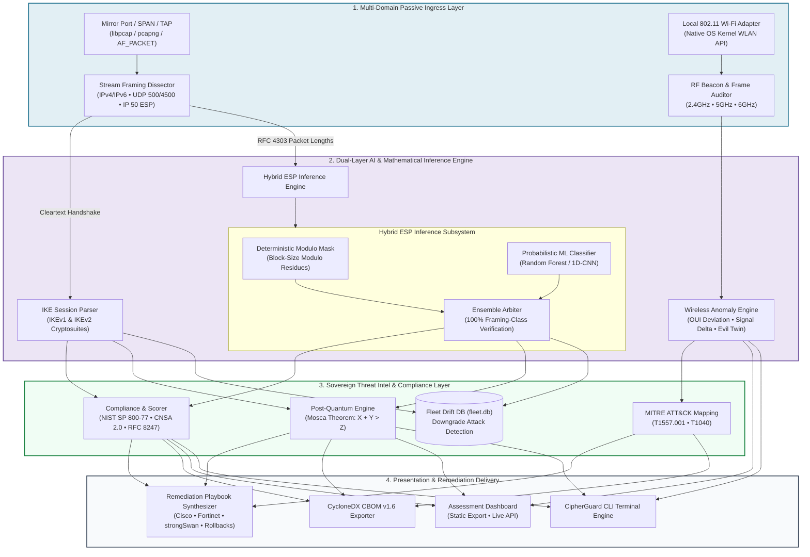

# System Architecture & Technical Specifications — CipherGuard

**System:** CipherGuard (AI-Powered Passive Protocol Analyzer & Wireless Auditor)  
**Target Standard:** SIH26160 / NTRO Defense Specifications  
**Document Version:** 1.0.0  

---

## 1. High-Level System Architecture

CipherGuard operates on a four-tier pipeline architecture designed for zero-decryption passive inspection across both physical wired TAP/SPAN ports and ambient 802.11 RF spectrometry.



---

## 2. The Epistemic Domain Model

A foundational architectural invariant in CipherGuard is the strict visual, logical, and structural separation of data by **epistemic certainty**:

```
+-------------------------------------------------------------------------------+
|                             EPISTEMIC ARCHITECTURE                            |
+------------------------------------+------------------------------------------+
|       OBSERVED DOMAIN (Teal)       |         INFERRED DOMAIN (Violet)         |
|         #1b6e8c / #e2eff4          |            #6d4e9c / #ece5f5             |
+------------------------------------+------------------------------------------+
| - Exact mathematical ground truth  | - Probabilistic AI / ML classification   |
| - Cleartext IKE protocol payloads  | - RFC 4303 packet length distributions   |
| - Unencrypted Wi-Fi beacon metrics | - ESP encryption suite candidate ranking |
| - SPIs, Nonces, DH Groups, PRFs    | - Inter-arrival entropy metrics          |
| - Zero uncertainty / No prediction | - Bounded confidence interval            |
+------------------------------------+------------------------------------------+
```

Every database record, UI badge, wire ribbon segment, and JSON key carries this epistemic marker, ensuring operators never mistake a statistical inference for a wire-observed fact.

---

## 3. Directory & Component Structure

```
cipherguard/                       # Repository root
├── README.md                      # Overview, method, validation, limitations
├── GETTING-STARTED.md             # Install and demo walkthrough
├── PRD.md                         # Product Requirements Document
├── Architecture.md                # System Architecture & Specifications (this file)
├── Rules.md                       # AI Engineering Boundaries & Invariants
├── Phases.md                      # Phased Implementation Roadmap
├── Design.md                      # UI/UX & Visual Design Tokens
├── Memory.md                      # Dynamic Project State Tracker
├── LICENSE, NOTICE                # Apache License 2.0 and attributions
├── pyproject.toml                 # Packaging, build system & metadata
├── requirements.txt               # Runtime, dashboard and test dependencies
├── Dockerfile                     # Container deployment image
├── render.yaml                    # Render deployment blueprint
├── launch_dashboard.bat           # One-click Windows launcher
│
├── cipherguard/                   # Core Python package
│   ├── cli.py                     # CLI entry point (18 subcommands)
│   ├── pipeline.py                # Capture file in, scored assessment out
│   │
│   ├── core/                      # Shared model and arithmetic
│   │   ├── models.py              # Data model shared by dissector, audit, inference and API
│   │   ├── constants.py           # IANA registry tables for IKEv1 / IKEv2 / ESP
│   │   ├── framing.py             # RFC 4303 framing arithmetic
│   │   ├── strength.py            # Quantified security strength
│   │   ├── grouping.py            # Findings grouped by rule, per-link views
│   │   ├── audit_log.py           # Structured audit logging
│   │   ├── health.py              # Sensor health checks
│   │   └── retention.py           # Evidence retention for window captures
│   │
│   ├── dissector/                 # Protocol Dissection Engine
│   │   ├── pcap.py                # Capture file I/O and L2/L3/L4 decoding
│   │   ├── ike.py                 # IKEv1 and IKEv2 dissector (one module)
│   │   ├── esp.py                 # ESP flow tracking
│   │   └── wire_inspector.py      # ESP wire framing and raw hex inspector
│   │
│   ├── ml/                        # ESP Inference Subsystem
│   │   ├── features.py            # Side-channel features for encrypted ESP flows
│   │   ├── synth.py               # Labelled ESP flows for training and calibration
│   │   ├── classifier.py          # Inference engine: Random Forest plus the modulo mask
│   │   ├── cnn.py                 # 1D-CNN implemented directly on NumPy
│   │   ├── train.py               # Model training & artifact serializer
│   │   └── validate.py            # Cross-model validation and mask ablation
│   │
│   ├── audit/                     # Compliance & Posture Engine
│   │   ├── engine.py              # Rules, 0-100 scoring and the rule catalogue
│   │   ├── policy.py              # Cryptographic policy baseline
│   │   ├── policy_config.py       # External policy overlay
│   │   └── plain.py               # One plain-language sentence per rule
│   │
│   ├── intel/                     # Baseline & Post-Quantum Exposure
│   │   ├── baseline.py            # SQLite baseline store and downgrade detection
│   │   └── pqc.py                 # Mosca theorem (X + Y > Z) exposure and sequencing
│   │
│   ├── wifi/                      # Wi-Fi Posture Auditing
│   │   ├── wlan_native.py         # Native Windows WLAN AutoConfig scanner
│   │   ├── auditor.py             # Wi-Fi posture auditor, Evil Twin & Rogue AP detector
│   │   └── models.py              # Wi-Fi assessment data structures
│   │
│   ├── vpn/                       # VPN Tunnel & Overlay Detection
│   │   ├── detector.py            # Active tunnels, route redirects, DNS leaks
│   │   └── models.py              # VPN detection data structures
│   │
│   ├── remediation/               # Vendor Configuration Synthesis
│   │   ├── synth.py               # Playbook synthesis for every supported platform
│   │   ├── rollback.py            # Rollback playbook synthesis
│   │   ├── syntax.py              # Syntax verification of generated playbooks
│   │   ├── dispatcher.py          # Dry-run validation and execution dispatcher
│   │   ├── store.py               # SQLite plan store with maker-checker approvals
│   │   └── models.py              # Remediation plan data structures
│   │
│   ├── export/                    # Machine-Readable Artifact Generation
│   │   ├── cbom.py                # CycloneDX v1.6 CBOM JSON serializer
│   │   ├── payload.py             # The analysis payload, built once for every client
│   │   ├── static_site.py         # `export-demo`: writes the static dashboard
│   │   └── live_wifi_snapshot.json  # Example Wi-Fi scan (invented networks)
│   │
│   ├── capture/                   # Live Capture
│   │   ├── live.py                # Live capture from a network interface
│   │   ├── live_sniffer.py        # Dashboard packet sniffer and event stream
│   │   └── sensor.py              # Continuous sensor mode
│   │
│   ├── lab/                       # Reference Testbed & Validation
│   │   ├── pcapgen.py             # Reference testbed capture generator
│   │   ├── labels.py              # User-labelled real captures
│   │   ├── realworld.py           # Validation against a public capture corpus
│   │   ├── fieldmodel.py          # Independent traffic model for cross-validation
│   │   └── bench.py               # Reproducible throughput benchmark
│   │
│   └── api/                       # Local FastAPI Server
│       ├── server.py              # FastAPI app and every route (REST under /api/)
│       └── static/                # The dashboard: index.html, 404.html,
│                                  #   css/dashboard.css, js/dashboard.js,
│                                  #   js/theme-init.js, fonts/, img/
│
├── docs/                          # Output of `cipherguard export-demo` (GitHub Pages root):
│                                  #   a copy of api/static/ plus precomputed data/
├── tests/                         # Automated Pytest suite (421 tests)
├── scripts/                       # Release, soak, capture-fetch and export helpers
├── deploy/                        # systemd unit for the sensor
├── samples/                       # Reproducible sample PCAP captures
├── models/                        # Serialized model weights (rf.joblib, cnn.npz)
└── docker/                        # strongSwan interoperability lab
```

---

## 4. Subsystem Deep-Dives

### 4.1 Hybrid ESP Inference: RFC Modulo Mask + ML
Encrypted ESP packets conceal the cipher suite, but RFC 4303 requires the payload to be padded to a multiple of the cipher's block size $B$:
$$L_{\text{encrypted}} = L_{\text{IV}} + L_{\text{plaintext}} + L_{\text{pad}} + 1 (\text{PadLen}) + 1 (\text{NextHdr}) + L_{\text{ICV}}$$

- **Deterministic Constraint**: By taking $L \pmod B$ across hundreds of packets in a Security Association (SA), CipherGuard constructs an admissibility mask.
  - A stream or 128-bit AEAD cipher (AES-GCM) allows 1-byte padding increments.
  - A 64-bit block cipher (3DES) forces 8-byte boundaries.
  - A 128-bit CBC cipher (AES-CBC) forces 16-byte boundaries.
- **Probabilistic ML**: A Random Forest classifier evaluates packet length histogram percentiles (p10, p25, p50, p75, p90, p99), flow direction ratios, and payload variance.
- **Ensemble Result**: The ML prediction is strictly gated by the modulo mask. Even if ML confidence is high for a 64-bit cipher, if the wire exhibits 16-byte padding residues, the 64-bit candidate is masked out. This achieves **100% framing-class accuracy**.

### 4.2 Local 802.11 RF Spectrometry & Anomaly Scoring
The Wi-Fi auditor interfaces directly with the native OS kernel networking stack without relying on external packet-capturing drivers (such as WinPcap/Npcap):
- **Windows**: Invokes `netsh wlan show networks mode=bssid` and parses native UTF-8 network output.
- **Linux**: Queries `iw dev <interface> scan` or `nmcli -t -f ALL dev wifi`.
- **Rogue AP Scorer**: Evaluates each observed BSSID against three threat vectors:
  1. $\Delta_{\text{OUI}}$: Discrepancy between IEEE MAC OUI registry vendor and beacon vendor element.
  2. $\Delta_{\text{RSSI}}$: Signal divergence indicating an Evil Twin positioned closer to the host than the legitimate AP.
  3. $\Delta_{\text{Auth}}$: Open network matching an enterprise ESSID name.

### 4.3 SQLite Fleet Baseline & Downgrade Watcher (`fleet.db`)
Tracks the historical cryptographic trajectory of all audited peer pairs:
- **Table `peer_baselines`**:
  - `peer_pair_id` (TEXT PRIMARY KEY, e.g., `192.168.1.10:192.168.1.20`)
  - `first_observed_ts` (INTEGER)
  - `last_observed_ts` (INTEGER)
  - `ike_version` (INTEGER)
  - `encryption_suite` (TEXT)
  - `prf_algorithm` (TEXT)
  - `dh_group` (INTEGER)
  - `effective_key_bits` (INTEGER)
  - `posture_score` (REAL)
- **Downgrade Evaluation**: When analyzing a new capture, if `effective_key_bits < baseline.effective_key_bits`, the engine flags an active **Downgrade Threat (Exit Code 3)**.

---

## 5. Technology Stack Specifications

| Layer | Technology | Version | Purpose & Rationale |
|---|---|---|---|
| **Language** | Python | `>=3.10` | Core backend, dissection, and ML processing. Strict type hint compliance. |
| **Numerical/ML** | NumPy, scikit-learn, joblib | `>=1.24`, `>=1.3` | Matrix manipulation, Random Forest inference, model serialization. Zero heavy deep learning runtime overhead. |
| **API Framework** | FastAPI, Uvicorn, Pydantic | `>=0.110`, `>=0.27`, `>=2.0` | REST API with one server-sent event stream and automatic schema validation. |
| **Testing** | Pytest, HTTPX | `>=7.4`, `>=0.26` | Unit, integration, and mock API testing suite. |
| **Frontend Core** | HTML5, Vanilla JavaScript (ES2022) | Modern Standard | Dependency-free, lightweight, responsive client logic. Zero external bundlers needed. |
| **Styling** | Vanilla CSS3 | Custom CSS Tokens | Epistemic color coding, high-density tactical layout, glassmorphic HUD styling. **No Tailwind**. |
| **OS Wireless** | Windows WLAN / Linux `iw` | Kernel Native | Driverless, non-intrusive 802.11 ambient spectrum telemetry extraction. |

---

## 6. Deployment Topologies

1. **Standalone CLI Mode**:
   ```bash
   python -m cipherguard.cli analyze samples/backbone.pcap -v
   ```
2. **Local Telemetry Dashboard Mode**:
   ```bash
   python -m cipherguard.cli serve --port 8000
   ```
   Serves the live interactive dashboard backed by FastAPI.
3. **Static Air-Gapped / GitHub Pages Mode**:
   Browse `docs/index.html` directly or serve via any static web server (Nginx, Apache, Caddy, GitHub Pages). Operates fully with preloaded scenario datasets.
4. **StrongSwan Containerized Testbed**:
   `docker/` contains automated multi-gateway IPsec topologies for live verification against live IKEv1/IKEv2 daemon negotiations.
