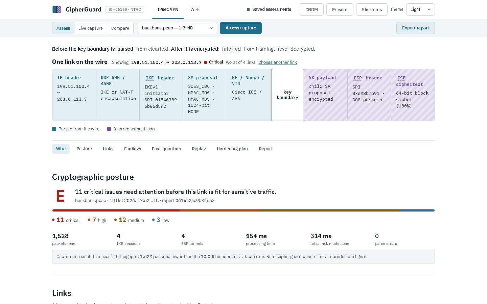
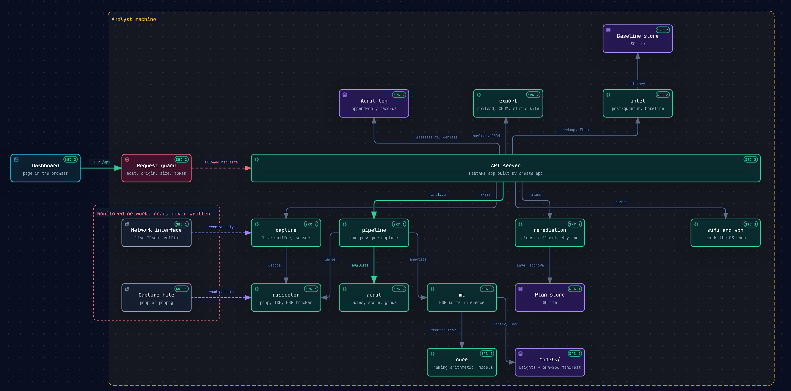
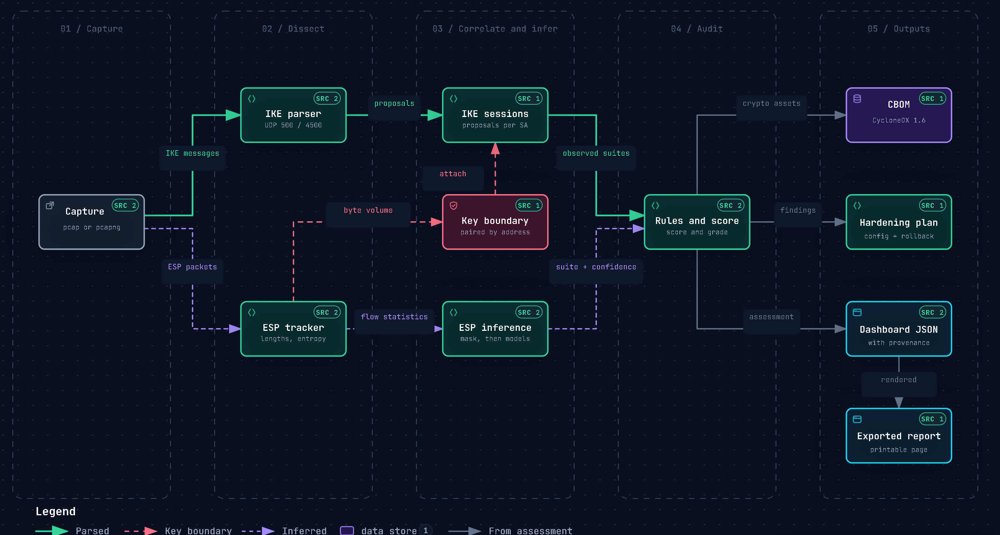

# CipherGuard

A passive analyzer for IPsec VPN traffic. Given a packet capture or a mirror
port, it reports which gateways negotiate weak cryptography, estimates the
cipher protecting each ESP tunnel without decrypting anything, and writes the
configuration that fixes what it found. It holds no keys, logs into no device
and changes no configuration.

Smart India Hackathon 2026 · Problem statement SIH26160 · National Technical
Research Organisation (NTRO)

[Static demo](https://git-huber2007.github.io/CipherGuard/) ·
[Method and validation](METHOD.md) · [Operations](OPERATIONS.md) ·
[Architecture](ARCHITECTURE.md)



## The problem

An agency with hundreds of IPsec gateways needs to know which of them still
negotiate broken cryptography. Reading each device's configuration needs
credentials and a change window, and shows the intended policy, not what two
peers actually settled on.

Reading it off the wire has a hard limit. The IKE proposal (cipher, PRF,
integrity, DH group) is cleartext. The ESP suite protecting the data is
negotiated inside an encrypted payload and cannot be read. CipherGuard parses
the first and infers the second from packet framing, and it keeps the two
apart everywhere: a value is either **observed** or **inferred**, and an
inferred value always carries a confidence and its candidate set.

## What it does

| Capability | How | Check it yourself |
|---|---|---|
| IKEv1 and IKEv2 dissection | Pure-Python reader for pcap and pcapng; proposals, transforms, DH groups, vendor IDs, lifetimes, RFC 9370 hybrid key exchanges | `cipherguard verify-real` (5 of 5 public Wireshark captures) |
| ESP suite inference without keys | RFC 4303 padding arithmetic as a hard constraint, with a Random Forest and a small NumPy CNN ranking what the arithmetic leaves open | `cipherguard validate` |
| Audit and scoring | 20 rules against NIST SP 800-77 Rev. 1 and RFC 8247, a 0 to 100 score, and an agency policy overlay | `cipherguard rules`, `cipherguard analyze samples/backbone.pcap -v` |
| Downgrade detection | SQLite baseline of the strongest suite seen per peer pair; exit code 3 when a link gets weaker | `cipherguard watch` (see the demo below) |
| Post-quantum exposure | Links ranked by harvest-now-decrypt-later exposure using Mosca's inequality | `cipherguard roadmap samples/backbone.pcap` |
| Cryptographic bill of materials | CycloneDX 1.6, built from observed traffic, with provenance on every asset | `cipherguard cbom samples/backbone.pcap -o bom.json` |
| Hardening plans | Configuration and a matching rollback for Cisco IOS / IOS-XE, strongSwan, FortiOS and Junos. Generated for review; nothing is sent to a gateway | `cipherguard remediate samples/backbone.pcap -o out/` |
| Wi-Fi audit | Reads the operating system's own scan (`netsh` on Windows, `nmcli` on Linux); flags weak security and a cloned network name | Wi-Fi tab of the dashboard |
| Dashboard | One page, no framework and no build step; runs against the server or as a static export. Light and dark themes, keyboard shortcuts (Alt + H lists them), a presentation mode and a printable report | `cipherguard serve` |

Whether each of these is something SIH26160 asks for is for the problem
statement to say; this table lists only what the code does.

## Quick start

Python 3.10 or newer. The repository ships the sample captures and a trained
model, so there is nothing to generate first. There is no account or password:
a local run needs no credentials.

**Windows:** double-click `launch_dashboard.bat`. On first run it creates
`.venv`, installs dependencies from `requirements.lock` (falling back to
`requirements.txt`), polls until the server answers, and opens the dashboard.
If `.venv` already exists it is used as it is. Supported flags from cmd:
`--port N`, `--lan` (network access behind a token), `--no-browser`, and `--help`.

**Any platform:**

```bash
python -m venv .venv
source .venv/bin/activate            # Windows: .venv\Scripts\activate
pip install -r requirements.lock
python -m cipherguard serve          # http://127.0.0.1:8000
```

Pick a capture and select **Assess capture**. The page opens on the IPsec view;
the Wi-Fi view, live capture and a two-capture comparison are one click away.
To put the `cipherguard` command
on your path, run `pip install -e .`; every example below also works as
`python -m cipherguard ...`.

[GETTING-STARTED.md](GETTING-STARTED.md) has the step-by-step version and a
troubleshooting table.

## A five-minute demo

```bash
# 1. The same tool on a broken gateway and a hardened one
cipherguard analyze samples/legacy.pcap
cipherguard analyze samples/hardened.pcap

# 2. A downgrade no single capture can show: 128 bits, then 80, same peers
cipherguard watch samples/hardened.pcap  --db demo.db
cipherguard watch samples/downgrade.pcap --db demo.db     # exits with code 3

# 3. A link that has migrated to a post-quantum hybrid, and one that only offered it
cipherguard analyze samples/pqc_hybrid.pcap
cipherguard analyze samples/pqc_declined.pcap

# 4. What the learned models contribute, and what the arithmetic does
cipherguard validate

# 5. Outputs for other tools and for the change request
cipherguard cbom samples/backbone.pcap -o bom.json
cipherguard remediate samples/backbone.pcap -o hardening/
```

The captures under `samples/` are generated by `cipherguard lab` and are
labelled as lab traffic wherever they appear. Their addresses come from the
documentation ranges (203.0.113.0/24, 198.51.100.0/24).

## How it works

[](https://git-huber2007.github.io/CipherGuard/diagrams/cipherguard-components.html)

[](https://git-huber2007.github.io/CipherGuard/diagrams/capture-to-report.html)

Select a diagram to open the explorable version, where each node links to the
source it was drawn from. A third diagram follows
[one assess request](https://git-huber2007.github.io/CipherGuard/diagrams/assess-capture.html) through the server.

ESP inference is mostly arithmetic. RFC 4303 pads the encrypted region to the
cipher's block size, so every packet length on one SA shares a residue fixed by
the block size, IV length and ICV length. That residue rules suites out with
certainty. The learned models only rank what is left, and a model output that
contradicts the arithmetic is discarded. [METHOD.md](METHOD.md) has the
derivation.

## Measured results

Each figure is printed by the command beside it. The seed is fixed, so a rerun
gives the same numbers with the pinned dependencies.

| Measurement | Result | Command |
|---|---|---|
| Framing class, 360 held-out flows | 100.0% | `cipherguard train` |
| Exact suite, same flows | 60.6% | `cipherguard train` |
| Framing class on an independent traffic generator, 270 flows | 100.0% | `cipherguard validate` |
| Same, learned models alone with the mask disabled | 73.7% | `cipherguard validate` |
| Flows the arithmetic resolves with no model at all | 92.2%, none wrong | `cipherguard validate` |
| Real IKE captures from the Wireshark test suite | 5 of 5 parsed correctly | `cipherguard verify-real` |

Read these with their limits:

- **Exact-suite accuracy cannot go much above 60%.** AES-GCM-128, AES-GCM-256,
  AES-CTR and ChaCha20-Poly1305 produce identical ESP framing, as do DES and
  3DES. The tool reports the framing class and names the candidates; every
  member of a class gets the same audit verdict.
- **The learned models overfit the generator.** On traffic from a different
  generator they reach 73.7% alone. The framing arithmetic is what holds the
  result at 100%.
- **ESP inference has not been validated against real tunnels.** The public
  captures contain IKE handshakes only. `cipherguard label-check` validates
  against a real capture once you supply the suite from the endpoint's own
  configuration.

## Tech stack

| Layer | What | Used for |
|---|---|---|
| Language | Python 3.10+ | Everything. The dissector and capture reader use the standard library only |
| Inference | NumPy, scikit-learn, joblib | Features, Random Forest, model files. The CNN is written directly on NumPy |
| API | FastAPI, Uvicorn, Pydantic, python-multipart | `cipherguard serve` only |
| Storage | SQLite (standard library) | Baseline store and plan store |
| Front end | HTML, CSS, JavaScript | No framework, no bundler, no CDN. IBM Plex is bundled |
| Tooling | pytest, Ruff, pre-commit, GitHub Actions | Tests, lint and format, CI |

## Configuration

Nothing needs configuring for a local run. [.env.example](.env.example) lists
the same variables with comments.

| Variable | Default | Purpose |
|---|---|---|
| `CIPHERGUARD_TOKEN` | unset | Bearer token the API requires. Needed for any bind other than loopback |
| `CIPHERGUARD_CORS_ORIGINS` | unset | Comma-separated web origins allowed to call the API from a browser. A wildcard is rejected |
| `CIPHERGUARD_ALLOWED_HOSTS` | unset | Extra host names the server answers to when no token is set |
| `CIPHERGUARD_EGRESS_LOOKUP` | `0` | Set to `1` to let the Wi-Fi view ask a public service for this machine's public address |
| `PORT` | `8000` | Port for `cipherguard serve` when `--port` is not given |

To serve other machines, set a token:

```bash
CIPHERGUARD_TOKEN=$(python -c "import secrets; print(secrets.token_hex(32))") \
  cipherguard serve --host 0.0.0.0
```

A container image is described by the `Dockerfile`; it refuses to start
without `CIPHERGUARD_TOKEN`, for the same reason.

## Security defaults

The dashboard shows which links are weak, which is what an attacker wants to
know, so the server is closed by default.

- Binds to `127.0.0.1`. Any other address is refused unless a token is set.
- Without a token it answers loopback host names only, and refuses
  state-changing requests that come from another web site.
- Cross-origin access is off unless specific origins are named.
- Every response carries a content security policy that allows scripts from
  the server's own files only. The page uses no inline script and no inline
  event handlers, and text taken from a capture (network names, vendor IDs,
  file names) is escaped before it is shown.
- Repeated wrong tokens lock the client out for a minute. Request bodies and
  uploads are size-limited before they are read.
- No outbound network calls, no analytics, no CDN.
- Model files are checked against a SHA-256 manifest before they are loaded.

There is no TLS and no per-user identity; put the server behind a reverse
proxy that provides both before exposing it. The full list of issues found in
this code and how each was fixed is in
[OPERATIONS.md](OPERATIONS.md#security-posture-of-the-analyzer-itself). To
report a vulnerability, see [SECURITY.md](SECURITY.md).

## Limitations

- Payload content is never recovered. There is no decryption path.
- Framing-identical ESP suites cannot be told apart, by this tool or any
  passive one.
- Inference needs volume: under about 60 packets a finding is marked
  provisional.
- Continuous capture (`cipherguard sensor`) is Linux only and needs
  `CAP_NET_RAW`. The dashboard's own live-capture panel is a simpler path that
  has been tested with constructed packets, not real IPsec traffic.
- Hybrid (RFC 9370) dissection is validated against the lab generator, not
  against a capture from a real implementation.
- The systemd unit has not been started on a real Linux host, and the
  container image has not been built outside CI.

[METHOD.md](METHOD.md#limitations) has the complete list.

## Tests

```bash
pip install -r requirements.lock     # the pinned versions the model was trained with
pip install -e ".[dev]"
ruff check . && ruff format --check .
python -m pytest tests/              # about 4 minutes
python -m pytest tests/ -m "not soak"
```

The suite covers the dissector against independently built packets, 14,000
fuzzed inputs, the framing invariants, scoring, the baseline store, the API's
request-level protections, and the dashboard's formatting and arithmetic under
Node. It also holds the front end to its own rules: colours come from tokens,
no stylesheet rule is unused or defined twice, and `docs/` matches the live
files. The live-capture tests skip without packet-capture privileges. Fourteen tests need the public Wireshark captures and skip until they are
fetched with `scripts/fetch-real-captures.sh` (or `.ps1` on Windows).

## Repository layout

```
cipherguard/        Python package: dissector, ml, audit, intel, remediation, api, ...
  api/static/       The dashboard (index.html, css/, js/, fonts/)
docs/               Static export of the dashboard, written by `cipherguard export-demo`
samples/            Lab captures written by `cipherguard lab`
models/             Trained model and its SHA-256 manifest
tests/              pytest suite
scripts/            Soak test, capture fetch, release helpers
deploy/             systemd unit for the sensor
docker/             strongSwan interoperability lab
PRODUCT.md          Who the dashboard is for and what each screen is for
DESIGN.md           The dashboard's design rules: colour, type, spacing, components
```

[ARCHITECTURE.md](ARCHITECTURE.md) describes every module and the design rules
the code is held to.

## Licence and third-party material

CipherGuard is licensed under the [Apache License 2.0](LICENSE).

| Material | Licence | How it is used |
|---|---|---|
| IBM Plex Sans and IBM Plex Mono | SIL Open Font License 1.1 | Bundled in `cipherguard/api/static/fonts/`, licence text alongside |
| NumPy, scikit-learn, joblib, Uvicorn | BSD 3-Clause | Installed dependencies, not redistributed |
| FastAPI, Pydantic | MIT | Installed dependencies, not redistributed |
| python-multipart | Apache 2.0 | Installed dependency, not redistributed |
| Wireshark test captures | Wireshark project | Downloaded on demand by `scripts/fetch-real-captures.*`; not included in this repository |
| strongSwan and netshoot container images | Their own licences | Pulled by `docker/docker-compose.yml` for the optional lab; not included |

Cisco, Fortinet, Juniper and strongSwan are named only to say which
configuration syntax a hardening plan is written in. CipherGuard is not
affiliated with or endorsed by any of them.

## Team

Team CipherGuard · Team ID SIH2026-T8842
